<p align="center">
  
</p>

<h1 align="center">Cisco ISR 1100 — Secure Data Sanitization &amp; IOS XE Firmware Restoration Infrastructure Project</h1>

<p align="center"><strong>Cisco C1111-8PWB · IOS XE 16.09.05 · Enterprise Network Infrastructure</strong></p>

<p align="center">
  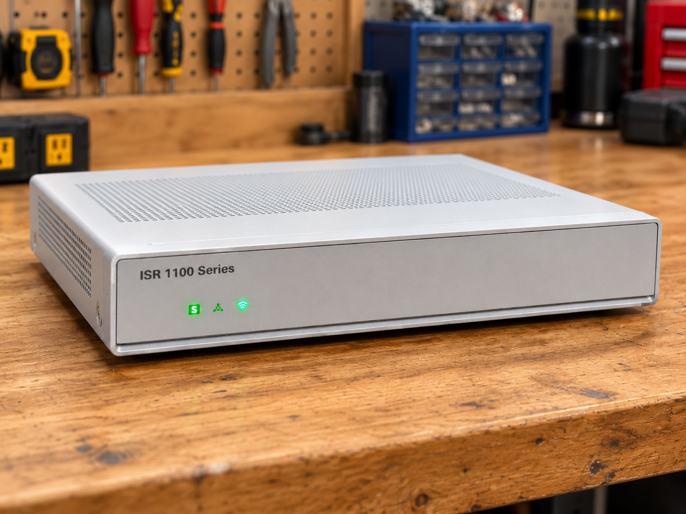
  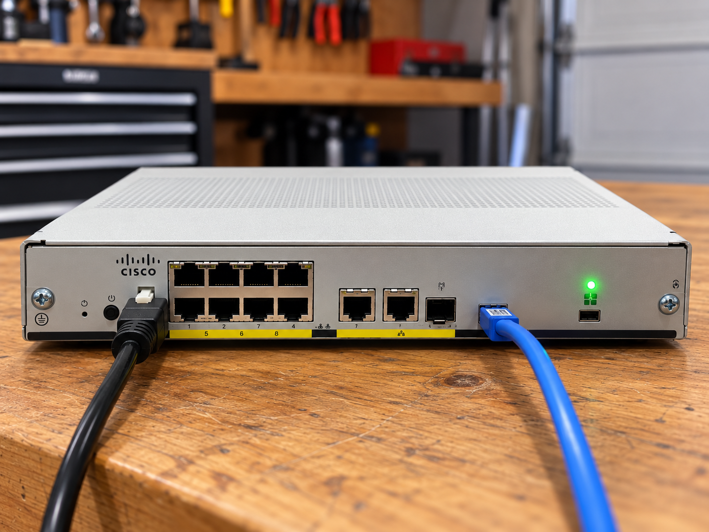
</p>
<p align="center"><sub>Front and rear views of the Cisco ISR 1100</sub></p>

## Overview

This project documents Cisco ISR 1100 maintenance involving **ROMMON recovery, IOS XE image backup and restoration, cryptographic-key handling, configuration removal, storage maintenance, and device diagnostics**. The sequence is supported by 19 redacted console screenshots.

| Hardware | Operating system | Access | Storage |
|---|---|---|---|
| Cisco C1111-8PWB | IOS XE 16.09.05 | Serial console / ROMMON | `bootflash:` · `usb0:` |

## Table of Contents

- [Overview](#overview)
- [Maintenance Procedure](#maintenance-procedure)
  - [Step 01 — ROMMON configuration register](#step-01)
  - [Step 02 — IOS XE version verification](#step-02)
  - [Step 03 — Hardware inventory](#step-03)
  - [Step 04 — Platform and wireless module inspection](#step-04)
  - [Step 05 — Interface status](#step-05)
  - [Step 06 — Ethernet diagnostics](#step-06)
  - [Step 07 — IPv4 routing table](#step-07)
  - [Step 08 — Running configuration](#step-08)
  - [Step 09 — Filesystem inventory](#step-09)
  - [Step 10 — IOS XE image backup to USB](#step-10)
  - [Step 11 — Cryptographic key maintenance](#step-11)
  - [Step 12 — VTP and boot-register configuration](#step-12)
  - [Step 13 — NVRAM and startup-config removal](#step-13)
  - [Step 14 — Bootflash formatting](#step-14)
  - [Step 15 — IOS XE image restoration](#step-15)
  - [Step 16 — Post-operation filesystem review](#step-16)
  - [Step 17 — VLAN inspection](#step-17)
  - [Step 18 — Module review and reload](#step-18)
  - [Step 19 — ROMMON environment review](#step-19)
- [Results and Verification](#results-and-verification)
- [Repository Structure](#repository-structure)

---

## Maintenance Procedure

The steps below follow the recorded command sequence. Commands and screenshots are included directly under each step.

<a id="step-01"></a>
### Step 01 — ROMMON configuration register

```text
rommon 1 > confreg 0x2142
rommon 2 > reset
```

`confreg 0x2142` set a recovery boot mode that bypasses the saved startup configuration. `reset` restarted the router with that setting. **This bypass does not erase the stored configuration.**

<p align="center">
  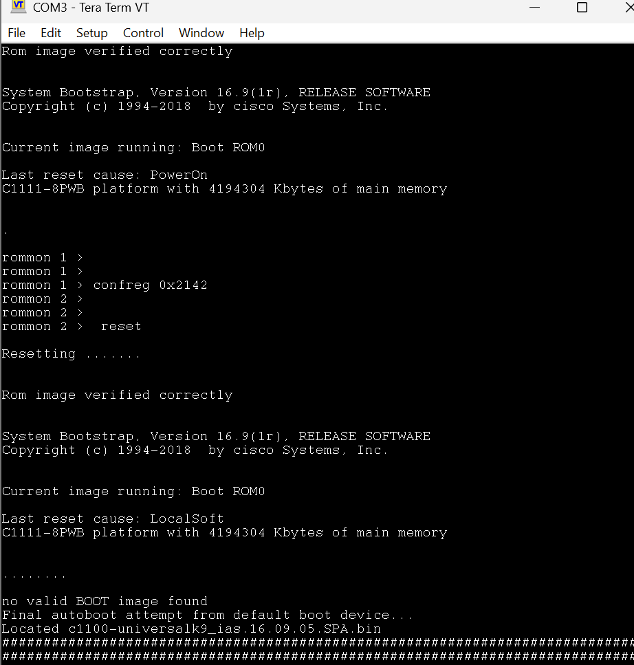
</p>

[↑ Back to Table of Contents](#table-of-contents)

---

<a id="step-02"></a>
### Step 02 — IOS XE version verification

```text
Router# terminal length 0
Router# show version
```

`terminal length 0` disabled output pagination so the full results could be captured. `show version` identified the router model, IOS XE release, and boot information.

<p align="center">
  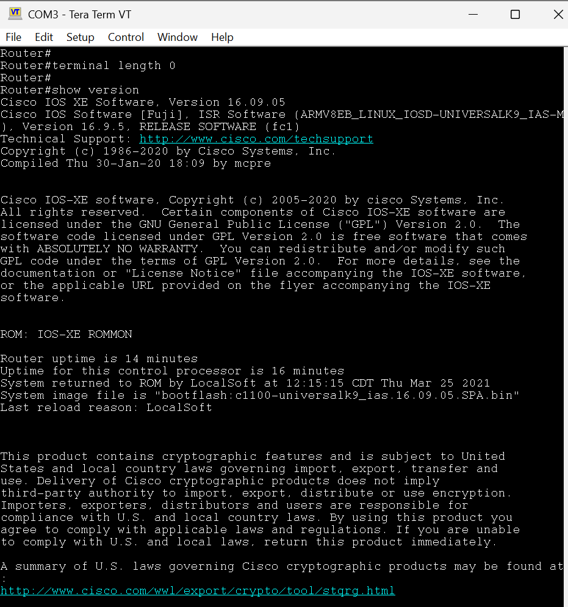
</p>

[↑ Back to Table of Contents](#table-of-contents)

---

<a id="step-03"></a>
### Step 03 — Hardware inventory

```text
Router# show inventory
```

`show inventory` identified the chassis and installed hardware by product and component records. Unique identifiers were redacted from the screenshot.

<p align="center">
  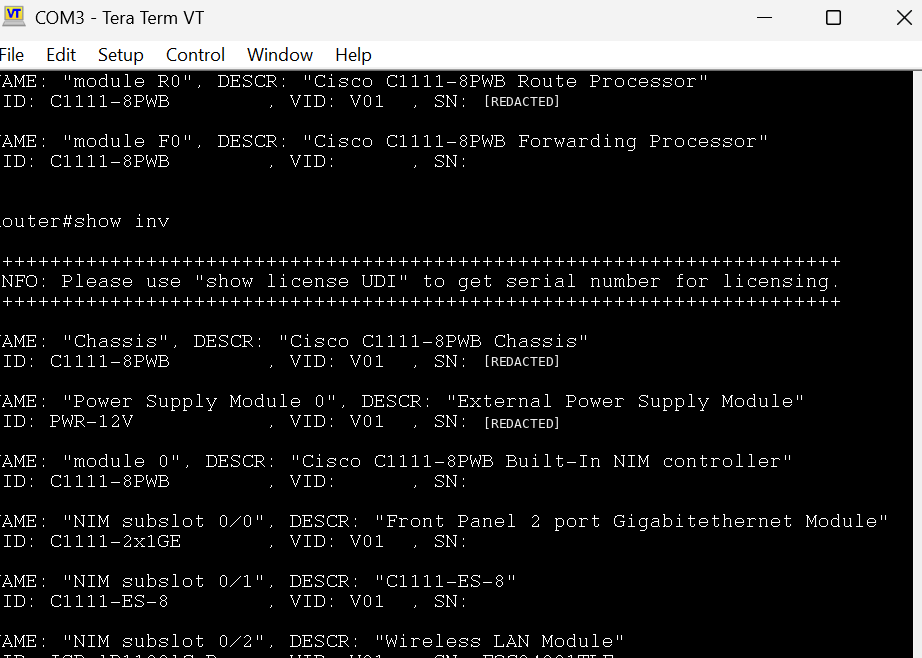
</p>

[↑ Back to Table of Contents](#table-of-contents)

---

<a id="step-04"></a>
### Step 04 — Platform and wireless module inspection

```text
Router# show platform
```

`show platform` displayed the operating state of installed modules, including the embedded wireless module, to establish a hardware baseline.

<p align="center">
  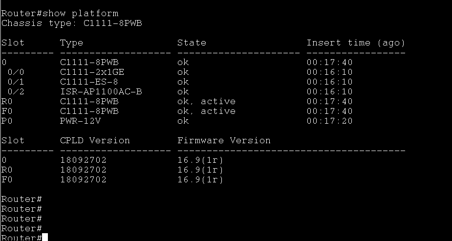
</p>

[↑ Back to Table of Contents](#table-of-contents)

---

<a id="step-05"></a>
### Step 05 — Interface status

```text
Router# show ip interface brief
```

`show ip interface brief` provided a quick view of interface IP addresses, administrative status, and protocol state before maintenance.

<p align="center">
  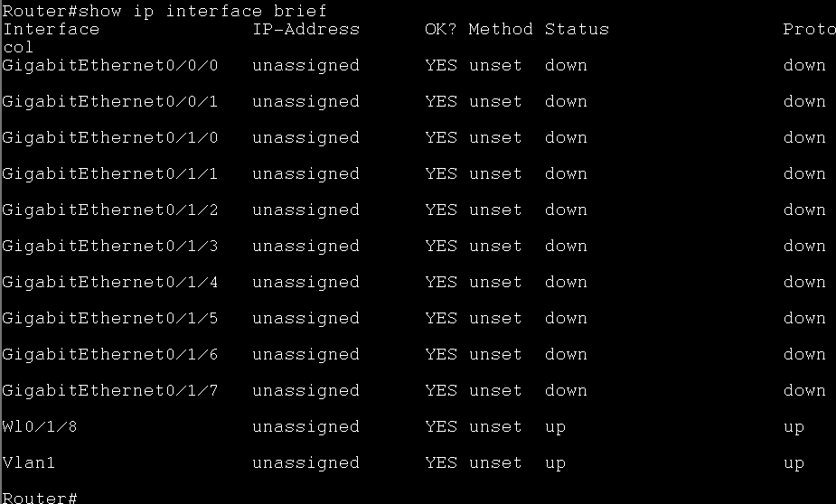
</p>

[↑ Back to Table of Contents](#table-of-contents)

---

<a id="step-06"></a>
### Step 06 — Ethernet diagnostics

```text
Router# show interfaces
```

`show interfaces` supplied detailed link statistics, including port states, traffic counters, and errors, to assess interface condition.

<p align="center">
  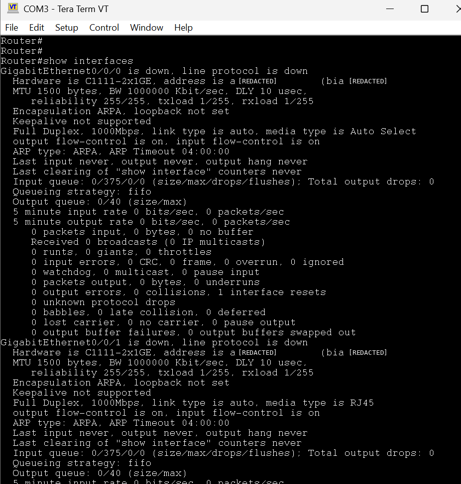
</p>

[↑ Back to Table of Contents](#table-of-contents)

---

<a id="step-07"></a>
### Step 07 — IPv4 routing table

```text
Router# show ip route
```

`show ip route` checked active IPv4 routes and the default-gateway state before configuration removal. No gateway of last resort was shown in the capture.

<p align="center">
  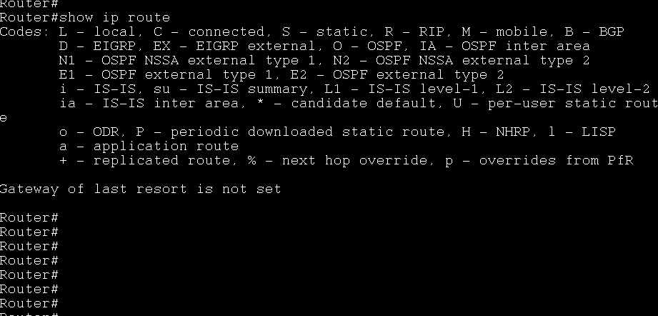
</p>

[↑ Back to Table of Contents](#table-of-contents)

---

<a id="step-08"></a>
### Step 08 — Running configuration

```text
Router# show running-config
```

`show running-config` reviewed the active IOS XE configuration before cleanup. The running configuration is distinct from the saved startup configuration.

<p align="center">
  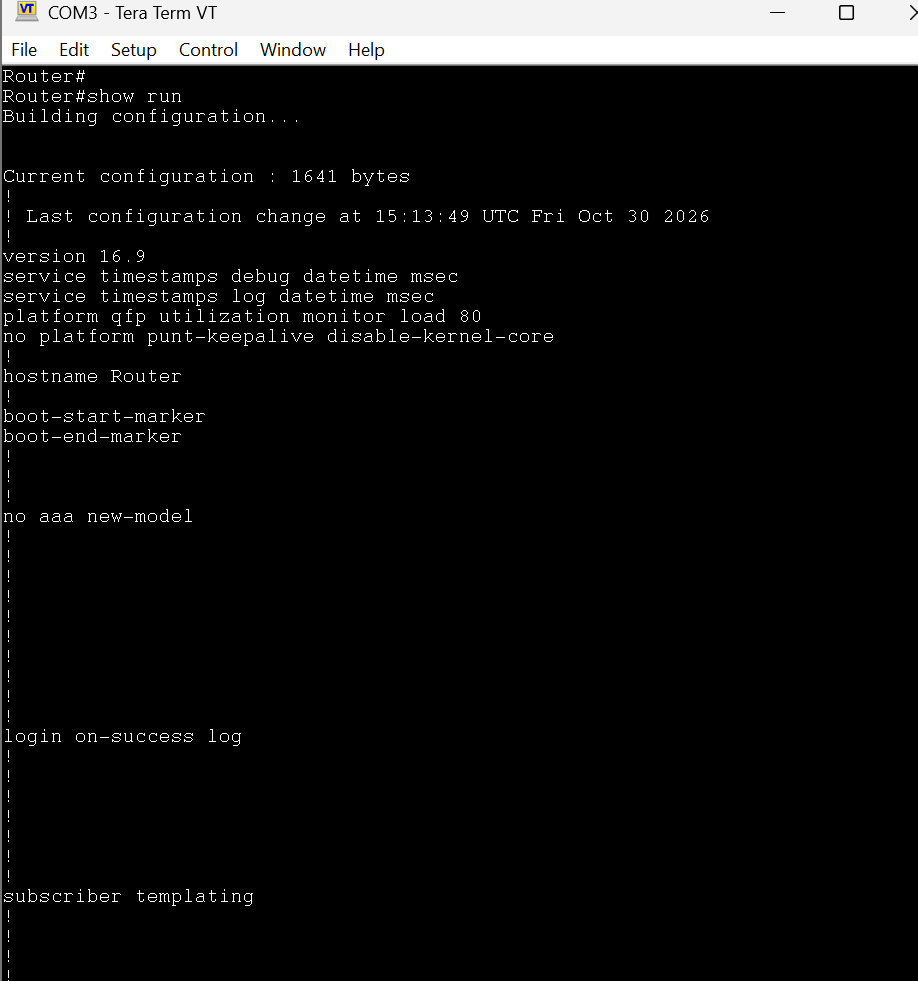
</p>

[↑ Back to Table of Contents](#table-of-contents)

---

<a id="step-09"></a>
### Step 09 — Filesystem inventory

```text
Router# dir all
```

`dir all` listed accessible filesystem entries to identify storage locations and files before image backup and formatting.

<p align="center">
  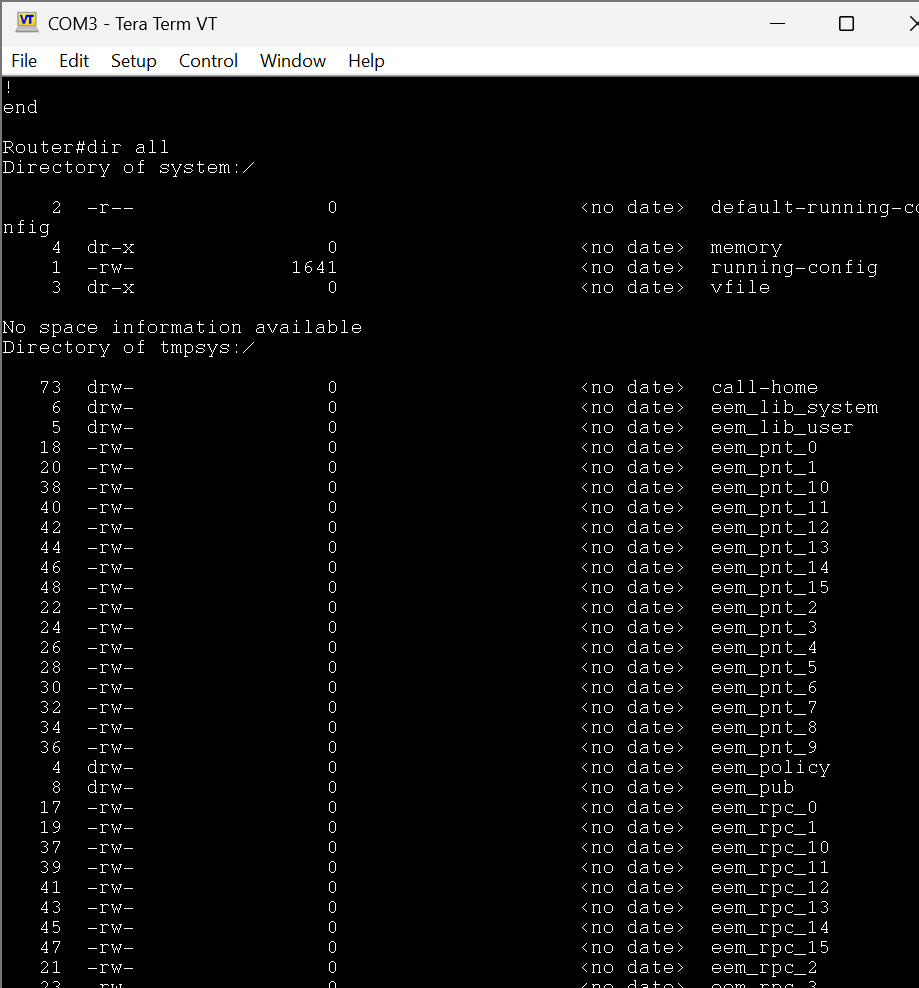
</p>

[↑ Back to Table of Contents](#table-of-contents)

---

<a id="step-10"></a>
### Step 10 — IOS XE image backup to USB

```text
Router# dir bootflash:
Router# copy bootflash: usb0:
Source filename []? c1100-universalk9_ias.16.09.05.SPA.bin
Destination filename [c1100-universalk9_ias.16.09.05.SPA.bin]?
```

`dir bootflash:` located the IOS XE image in internal storage. `copy bootflash: usb0:` initiated its backup to USB; the filename prompts selected the exact `.bin` file and destination name. **The screenshot shows transfer progress, not final copy verification.**

<p align="center">
  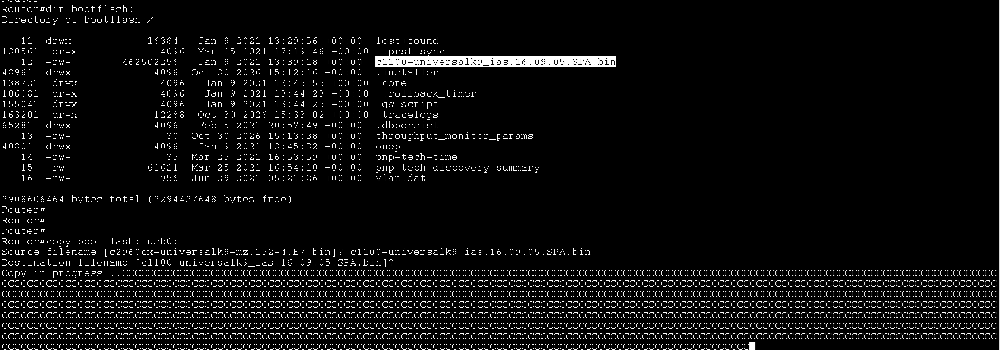
</p>

[↑ Back to Table of Contents](#table-of-contents)

---

<a id="step-11"></a>
### Step 11 — Cryptographic key maintenance

```text
Router# configure terminal
Router(config)# crypto key zeroize ?
Router(config)# crypto key zeroize ec
Router(config)# crypto key zeroize pubkey-chain
Router(config)# crypto key zeroize rsa
```

`configure terminal` entered configuration mode; `crypto key zeroize ?` displayed the available key categories. `crypto key zeroize ec`, `crypto key zeroize pubkey-chain`, and `crypto key zeroize rsa` targeted the recorded EC, public-key-chain, and RSA key material respectively.

<p align="center">
  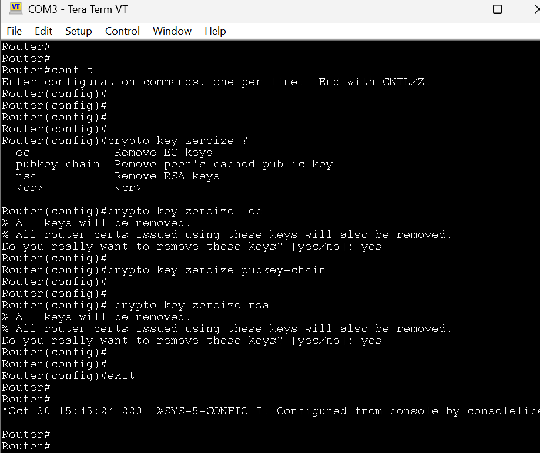
</p>

[↑ Back to Table of Contents](#table-of-contents)

---

<a id="step-12"></a>
### Step 12 — VTP and boot-register configuration

```text
Router# configure terminal
Router(config)# vtp domain null
Router(config)# config-register 0x2102
Router(config)# end
```

`configure terminal` entered configuration mode. `vtp domain null` set the VTP domain value shown in the session; `config-register 0x2102` restored the normal boot-register setting; `end` returned to privileged EXEC mode.

<p align="center">
  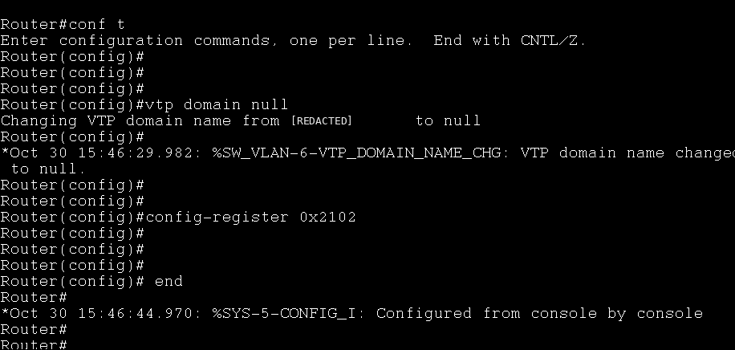
</p>

[↑ Back to Table of Contents](#table-of-contents)

---

<a id="step-13"></a>
### Step 13 — NVRAM and startup-config removal

```text
Router# erase /all nvram:
Router# erase startup-config
```

`erase /all nvram:` targeted the nonvolatile filesystem contents. `erase startup-config` separately removed the saved startup configuration so it would not be loaded at the next normal boot.

<p align="center">
  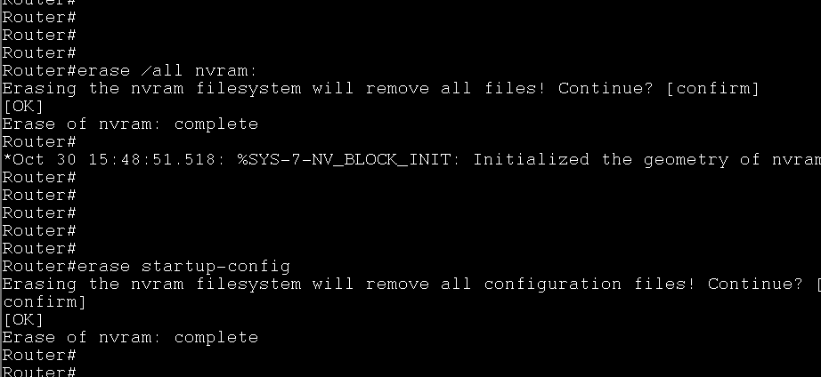
</p>

[↑ Back to Table of Contents](#table-of-contents)

---

<a id="step-14"></a>
### Step 14 — Bootflash formatting

```text
Router# format ?
Router# format bootflash:
Router# dir bootflash:
```

`format ?` checked supported formatting targets. `format bootflash:` reinitialized internal flash storage; `dir bootflash:` inspected the resulting directory. **Formatting alone does not establish forensic sanitization.**

<p align="center">
  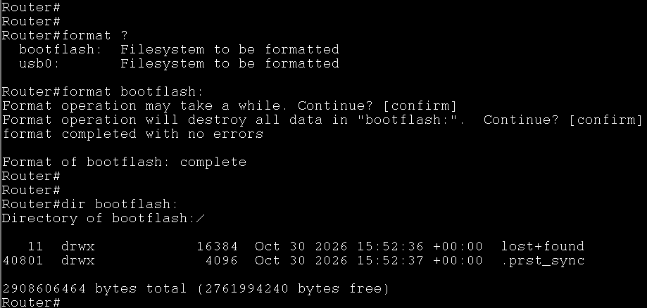
</p>

[↑ Back to Table of Contents](#table-of-contents)

---

<a id="step-15"></a>
### Step 15 — IOS XE image restoration

```text
Router# copy usb0: bootflash:
Source filename []? c1100-universalk9_ias.16.09.05.SPA.bin
Destination filename [c1100-universalk9_ias.16.09.05.SPA.bin]?
```

`copy usb0: bootflash:` initiated restoring the IOS XE image from USB to internal flash. The source and destination filename prompts identified the image being copied. **Transfer completion and a successful subsequent boot are not shown.**

<p align="center">
  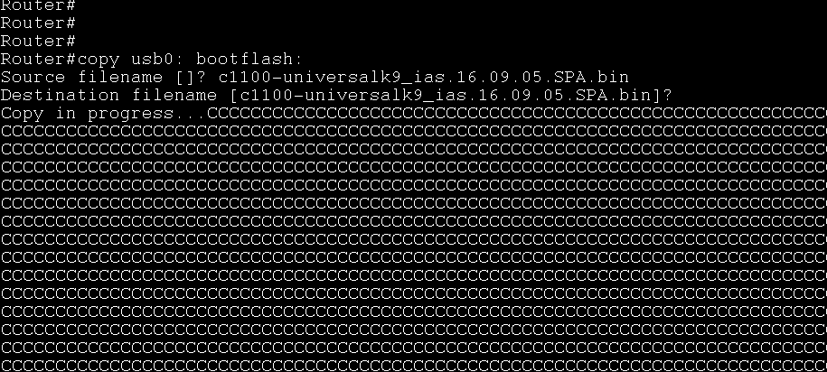
</p>

[↑ Back to Table of Contents](#table-of-contents)

---

<a id="step-16"></a>
### Step 16 — Post-operation filesystem review

```text
Router# dir all
```

`dir all` rechecked accessible filesystem entries after the storage and image operations to assess the visible post-maintenance state.

<p align="center">
  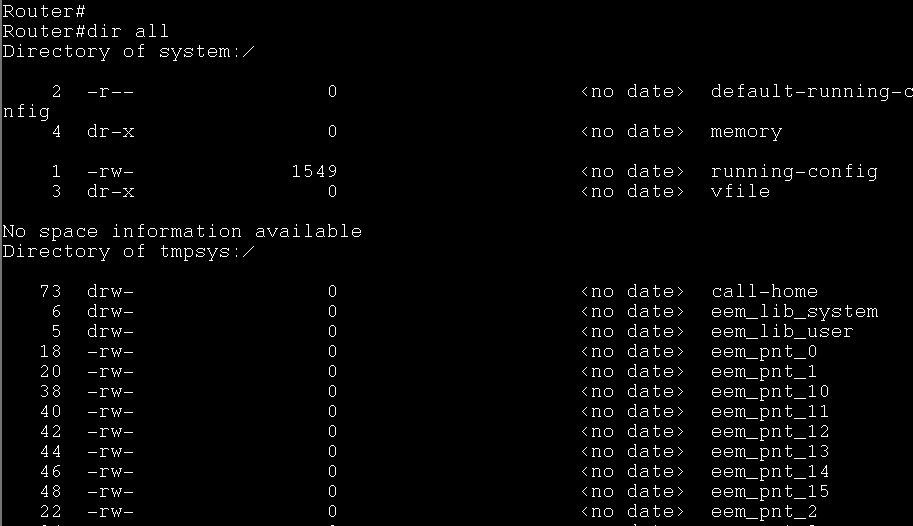
</p>

[↑ Back to Table of Contents](#table-of-contents)

---

<a id="step-17"></a>
### Step 17 — VLAN inspection

```text
Router# show vlan
```

`show vlan` reviewed the VLAN entries reported after configuration cleanup, including the default VLANs visible in the capture.

<p align="center">
  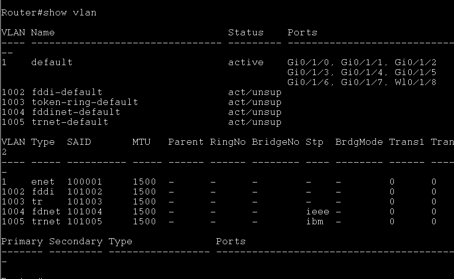
</p>

[↑ Back to Table of Contents](#table-of-contents)

---

<a id="step-18"></a>
### Step 18 — Module review and reload

```text
Router# show platform
Router# reload
```

`show platform` rechecked module state after maintenance. `reload` requested a restart so the router could boot with its current storage and boot settings; successful startup is not shown in the screenshot.

<p align="center">
  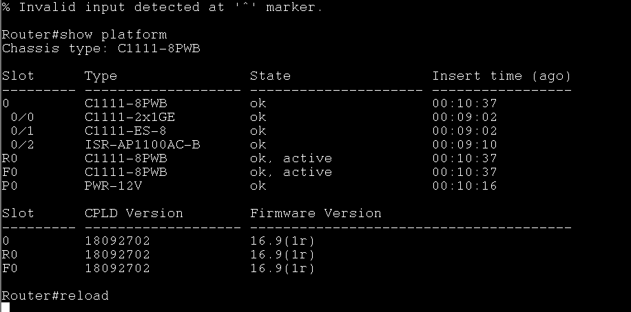
</p>

[↑ Back to Table of Contents](#table-of-contents)

---

<a id="step-19"></a>
### Step 19 — ROMMON environment review

```text
rommon 1 > set
```

`set` displayed the ROMMON environment variables to inspect boot-related settings after the reload sequence. This capture does not establish a successful final IOS XE boot.

<p align="center">
  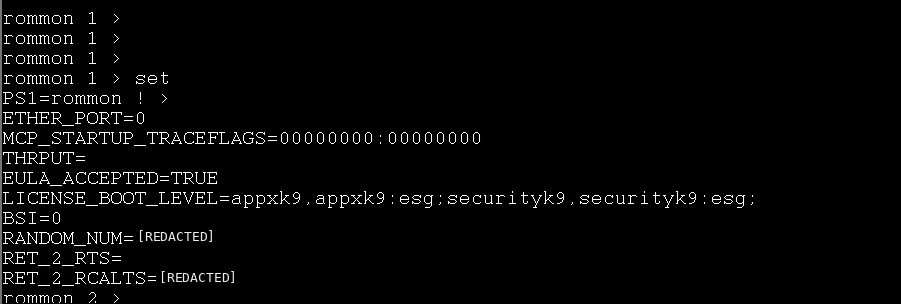
</p>

[↑ Back to Table of Contents](#table-of-contents)

---

## Results and Verification

The recorded console output confirms the router model and software version, platform and network inspections, selected key-management operations, configuration-erasure completion, and bootflash formatting. IOS XE image backup and restore transfers were initiated and progress was captured.

**Evidence limits:** The screenshots do not independently show completed image-transfer verification, a successful final IOS XE boot, or separate sanitization of the embedded wireless module. These are not represented as verified outcomes.

[↑ Back to Table of Contents](#table-of-contents)

## Repository Structure

```text
README.md
assets/
  brandons-logo.png
  footer-logo.png
evidence/
  router.png
  router-back.png
  step1.png ... step19.png
```

The console images have been redacted for publication. Operational identifiers and confidential configuration details are not included.

[↑ Back to Table of Contents](#table-of-contents)

---

<p align="center">
  
</p>
